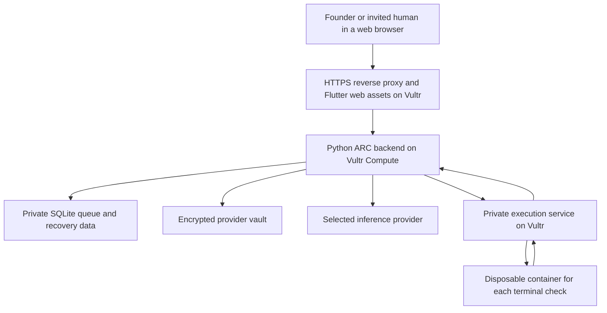

# ARC on Vultr

ARC is a company workspace where a founder talks to one CEO, delegates work through accountable managers, and follows real jobs to a verifiable result.

## Deployment status

**Deployed on Vultr Compute, 5 November 2026.**

Public demo: **[Open ARC](https://arc.64.177.59.174.sslip.io/)**. The application runs on one Ubuntu 24.04 x86_64 VM in **Atlanta (ATL)** with **2 vCPUs, 4 GB RAM, and 80 GB SSD storage**. Caddy provides HTTPS and serves the compiled Flutter application. The Python backend and terminal broker listen only on loopback. Company state and encrypted provider connections use private persistent VM directories outside the release. Vultr Serverless Inference is not configured or claimed.

Verified on the running Vultr VM: frontend assets and public API routing; a missing session capability is rejected; API documentation and detailed readiness routes return 404 publicly; four real execution isolation checks and one timeout/cleanup check pass. Provider credentials remain outside Git and outside execution containers. A real Gemini CEO reply through the public ARC API and a zero-price OpenRouter inference request from the deployed backend both succeeded. A recorded technical demo and full delegated company-job evidence remain separate submission tasks.

Recommended challenge: **Powering the Future of Work**, because ARC coordinates ongoing company jobs, AI roles, and human deliverables. The challenge selection remains the team's decision. **Blast Radius Zero** is an alternative that adds stricter inference and execution requirements.

The organizer currently lists the online build as **3-8 November 2026**. Recheck the [official event page](https://lablab.ai/ai-hackathons/vultr-hackathon) before submitting.

## The agent's use case

A founder gives the CEO a bounded goal, such as fixing a shipping-discount bug. The CEO delegates to a technology manager, the manager assigns an employee, and the worker inspects and changes project files. A restricted terminal runs checks against a disposable project snapshot. The work board records completed work, blocked work, pending human decisions, and test evidence.

ARC also supports finance, operations, marketing, and legal roles. These are software roles with different instructions and scoped assignments, not separately purchased subscriptions. They are not substitutes for qualified financial or legal professionals. Human employees receive only assigned group jobs, capacity information, and manager feedback. They cannot browse internal agent conversations.

## What works today

- A Flutter browser workspace, CEO chat, department marketplace, and company work board.
- Durable Python orchestration with saved teams, jobs, conversation state, and recovery data.
- A deterministic five-second queue check. Idle checks do not call a model.
- A user's saved provider/model connection across CEO, all internal roles, and background reviews.
- Human employee capacity, accept/decline, submission, manager review, and revocable invitations.
- Restricted local terminal execution on disposable Docker project copies.
- Local verification of a real code change, a passing agent test, and an independent passing test.
- 149 backend tests and 41 Flutter tests passed during the latest local verification.

Marketplace role prices are demo values. Model provider charges are separate. Automatic work has a request-count limit, not a guaranteed currency spending cap.

## Deployed Vultr architecture

**The following components run on the deployed Vultr VM.**



| Component | Purpose | Current state |
| --- | --- | --- |
| Vultr Compute VM | Central Python control layer and web application delivery | Running in Atlanta on Ubuntu 24.04 |
| Private VM SSD directories | Queue, recovery records, project data, and encrypted provider vault | Mounted from /var/lib/arc; no separate block-storage service used |
| HTTPS reverse proxy | Public web origin and authenticated internal API forwarding | Caddy running with a public TLS certificate |
| Private container execution service on Vultr | Run restricted checks outside the application process | Linux Docker broker; five real containment and timeout checks passed |
| Vultr Serverless Inference | All agent model calls for Challenge 1; optional for Challenge 2 | Not configured or tested |

Do not expose the backend, Docker socket, terminal gateway, database, or provider vault directly to the internet. Keep provider keys in the control layer and out of execution containers. Preserve one backend process for the current SQLite deployment. Configure and verify backups before relying on durable state.

### Track-specific requirements

| Requirement | Powering the Future of Work | Blast Radius Zero |
| --- | --- | --- |
| Public product-style web application on Vultr | Required | Required |
| Central backend on a Vultr VM | Required | Required |
| Vultr Serverless Inference | Optional | Required for agent LLM calls |
| Isolated execution on Vultr | Useful for ARC's code checks | Required |
| Recorded containment moment | Useful supporting evidence | Required |

For Challenge 2, personal provider connections can remain a product feature. For Challenge 1, the judged deployment must restrict all agent LLM calls to Vultr Serverless Inference; the general BYOK feature does not enforce that restriction today. The compatible inference base URL documented by the organizer is `https://api.vultrinference.com/v1`. Select an available model from the service with a valid key; do not invent model IDs or assume the deployment is tested.

## Current containment boundary and limits

The deployed terminal uses native Linux Docker; local Windows development retains the WSL adapter. Each disposable execution container runs as a non-root user, with no network, no host mounts, a read-only system, dropped Linux capabilities, and no-new-privileges. It limits memory to 256 MiB, CPU to one core, and process count to 64. Each command has a deadline and bounded output. The runner destroys the container after success or failure.

Only an allowlist of Git, search, and test commands can enter the terminal. Python is restricted to `python -m pytest`. Model credentials are not copied into the container. Tool scope and explicit denials still apply.

These controls have local and real Vultr execution-test evidence. They do not prove a hardened VM boundary. Existing workspace read/update tools operate on scoped project files in the control layer; do not describe every ARC tool action as sandboxed. Before claiming Challenge 1 compliance, isolate all relevant execution and file operations and enforce Vultr inference. The present deployment does not claim full Challenge 1 compliance.

## Reproduce the deployment

1. Confirm the challenge and activate event credits through the organizer's account flow. The current ARC VM was provisioned by the account owner.
2. Provision a Vultr VM and keep the administration and application network boundaries separate.
3. Build Flutter web assets for the public API origin. Serve assets and API requests through HTTPS.
4. Install the backend from `lib/backend/requirements.lock` using Python 3.13. Keep environment values outside source control.
5. Configure `ARC_ENVIRONMENT=production`, trusted hosts, allowed browser origins, a strong server access key, private data directories, and `ARC_COMPANY_WORKER_ENABLED=1`.
6. Use a trusted reverse proxy to supply the server access key internally. The current frontend sends a per-workspace session capability, not a shared server secret. Do not embed the backend access key in the Flutter build. Add end-user authentication appropriate to any production use beyond a controlled hackathon demo.
7. Deploy and verify the Linux terminal adapter using `deploy/vultr/README.md`. The native Linux adapter is now included, with the existing WSL implementation retained for local use. Do not give the backend or job containers the Docker socket. The private administrative broker alone needs it.
8. Configure persistent queue and vault storage, test restarts, and verify cross-workspace isolation. Protect the vault key with platform permissions and an appropriate recovery procedure.
9. For Challenge 1, configure Vultr Serverless Inference, enforce it for all agent model calls, and verify actual execution containment on Vultr.
10. Run a delegated company job, independently verify its result, and record the technical demo. The public application URL and actual Vultr services are recorded above.

## Local reproduction

```text
python -m venv .venv
# Activate the environment for your shell.
python -m pip install -r lib/backend/requirements.lock
flutter pub get
# Copy .env.example to .env and set values locally, never in Git.
python tools/run_backend.py
# In a second terminal with the environment active:
python tools/run_web.py --build
```

Open `http://127.0.0.1:8766/`. The loopback URL is a local preview, not a public submission URL. Provider configuration and terminal preparation are described in the root README.

## Evidence and reproduction commands

```text
flutter test
flutter analyze
python -m unittest discover -s lib/backend -p "test_*.py" -q
python tools/check_source_secrets.py
python tools/verify_developer_connection.py
python tools/verify_terminal_runtime.py
python tools/verify_terminal_connection.py
python tools/verify_free_agent.py --background --model <exact-compatible-model:free>
```

The live provider check requires the locally configured test key and permits only a verified zero-price model. The terminal checks require the installed local runtime. The code-work check requires an already paired terminal. These checks use synthetic projects, not a user's private files. Local reports are ignored under `.arc/`; publish only redacted evidence appropriate for the submission.

## Video containment demonstration

Use a disposable synthetic test that waits beyond the runner's deadline. Show the job entering the isolated runner, the timeout stopping it, and a normal follow-up check succeeding. Show that the application remains responsive. Never demonstrate destructive commands on the host. The existing `tools/verify_terminal_runtime.py` contains a bounded timeout check.

For Challenge 1, record this after the execution service is running on Vultr. An existing promotional video or local screenshot does not replace the required live technical demonstration.

## Submission checklist

- [ ] Confirm the selected challenge.
- [x] Public repository contains the current source, setup instructions, and this Vultr explanation.
- [x] Backend and web application run on Vultr, with an actual public HTTPS URL.
- [x] Record the Vultr services, region, and deployment evidence accurately.
- [ ] Record a technical demo showing an actual task and its result.
- [ ] If entering Challenge 1, enforce Vultr inference and show a containment moment on Vultr.
- [x] Prepare a PDF slide deck and cover artwork.
- [ ] Recheck that no secrets, personal invitations, or internal credentials appear in screenshots or Git history.

## Sources

- [Official lablab.ai event, challenges and submission requirements](https://lablab.ai/ai-hackathons/vultr-hackathon)
- [Vultr event overview and containment requirements](https://community.vultr.com/e/vultr-agent-rush-hackathon)
- Repository implementation: `company/work_runtime.py`, `company/work_store.py`, `company/work_policy.py`, `developer_connections.py`, `services/terminal_gateway.py`, and `terminal_policy.py`.

Requirements checked on 31 October 2026. Recheck the organizer's current rules at submission time.
